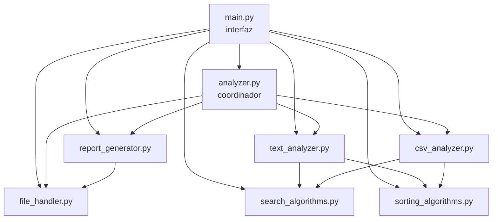
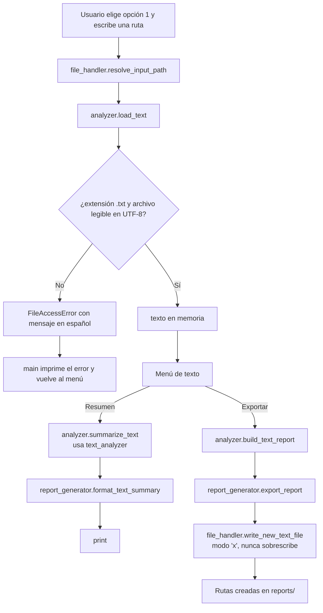

# Arquitectura

Este documento explica cómo está organizado el proyecto, cómo viaja la información y por qué se tomaron las decisiones de diseño.

## 1. Idea central: tres capas

El programa se divide en tres responsabilidades que no se mezclan:

| Capa | Módulos | Qué hace | Qué NO hace |
|---|---|---|---|
| **Interfaz** | `main.py` | Muestra menús, pide datos, valida lo que escribe el usuario, imprime resultados. | No calcula métricas ni abre archivos directamente. |
| **Lógica** | `text_analyzer.py`, `csv_analyzer.py`, `search_algorithms.py`, `sorting_algorithms.py`, `report_generator.py` (formato) | Recibe datos en memoria (strings, listas, diccionarios) y devuelve resultados. | No usa `input()`, no usa `print()`, no lee archivos. |
| **Acceso a archivos** | `file_handler.py` | Lee y escribe archivos; traduce errores del sistema a mensajes claros. | No sabe qué significa el contenido. |

`analyzer.py` es un pequeño **coordinador**: une las tres capas en operaciones completas ("leer este `.txt` y armar su informe").

¿Por qué separar así?

- **Pruebas simples:** `count_words("hola mundo")` se prueba con un string; no hace falta crear archivos ni simular el teclado.
- **Cambios localizados:** si mañana se reemplaza la consola por una interfaz gráfica, solo cambia `main.py`.
- **Errores en un solo lugar:** todo lo relacionado con permisos, codificación o rutas está en `file_handler.py`.

## 2. Componentes

| Módulo | Responsabilidad | Depende de |
|---|---|---|
| `main.py` | Menús, validación de entradas, impresión. | `analyzer`, `text_analyzer`, `csv_analyzer`, `search_algorithms`, `sorting_algorithms`, `report_generator`, `file_handler` |
| `analyzer.py` | Leer + analizar + armar informe. | `file_handler`, `text_analyzer`, `csv_analyzer`, `report_generator` |
| `text_analyzer.py` | Métricas de texto (funciones puras). | `search_algorithms`, `sorting_algorithms` |
| `csv_analyzer.py` | Interpretar CSV, validar, buscar, filtrar, ordenar, estadísticas. | `search_algorithms`, `sorting_algorithms` |
| `search_algorithms.py` | Búsqueda lineal y binaria. | (nada) |
| `sorting_algorithms.py` | Bubble sort y ordenamientos auxiliares. | (nada) |
| `report_generator.py` | Dar formato (texto, tabla, JSON, CSV) y exportar. | `file_handler` |
| `file_handler.py` | Leer/escribir archivos de forma segura. | (nada) |

Las dependencias van en una sola dirección (de arriba hacia abajo). Los algoritmos no dependen de nada, por eso se pueden reutilizar y probar de forma aislada. No hay importaciones circulares.

## 3. Flujo de la información

### Análisis de un texto y exportación

### Análisis de un CSV

1. `file_handler.read_text_file` devuelve el contenido como string.
2. `csv_analyzer.parse_csv_text` detecta el separador, valida encabezados y separa registros válidos de filas problemáticas. El resultado es una "tabla" (diccionario con `headers`, `records`, `record_lines`, `issues`).
3. Cada operación del menú (buscar, filtrar, ordenar, estadísticas) recibe la tabla y devuelve resultados nuevos; **la tabla original nunca se modifica**.
4. El último resultado de búsqueda, filtro u orden se guarda en una variable local del menú para poder exportarlo como CSV.

## 4. Manejo de errores

| Situación | Dónde se detecta | Qué ve el usuario |
|---|---|---|
| Opción de menú inválida | `main.ask_menu_option` | "Opción inválida" y la lista de opciones válidas; se vuelve a preguntar. |
| Número fuera de rango o no numérico | `main.ask_positive_int` | Mensaje y nueva pregunta. |
| Archivo inexistente, carpeta, sin permisos, no UTF-8, demasiado grande | `file_handler.read_text_file` → `FileAccessError` | Mensaje específico; se vuelve al menú. |
| Extensión incorrecta | `file_handler.validate_extension` | "Se esperaba un archivo .csv y se recibió '.txt'". |
| Encabezados vacíos o repetidos, comillas mal cerradas | `csv_analyzer.parse_csv_text` → `CsvFormatError` | Mensaje con la causa y la línea. |
| Filas con campos de más o de menos, filas vacías | `csv_analyzer.parse_csv_text` | Se informan como "problemas de formato"; el análisis continúa. |
| Valores no numéricos en columnas numéricas | `csv_analyzer.parse_number` | Se informan con su línea y se excluyen de los cálculos. |
| Carpeta de informes sin permisos u ocupada por un archivo | `file_handler.ensure_directory` | "Error al exportar: ..." |
| Fin de entrada (Ctrl+D / Ctrl+Z) o Ctrl+C | `main.main` | "Programa interrumpido por el usuario." y salida con código 0. |

Principios aplicados:

- **Excepciones específicas.** Se capturan `PermissionError`, `UnicodeDecodeError`, `FileExistsError`, `csv.Error`, `ValueError`, etc. No hay `except Exception` que oculte errores inesperados: si ocurre un error de programación, Python lo muestra completo, lo cual es deseable durante el desarrollo.
- **Traducción en el borde.** Los errores técnicos se convierten en `FileAccessError` o `CsvFormatError` con mensajes comprensibles, conservando el error original (`raise ... from error`) para depuración.
- **La interfaz decide qué mostrar.** La lógica lanza excepciones; `main.py` las captura y las imprime.

## 5. Decisiones de diseño

| Decisión | Motivo |
|---|---|
| Solo biblioteca estándar | El objetivo es aprender fundamentos; `pandas` o similares ocultarían justamente lo que se quiere enseñar. Además el proyecto se instala sin descargar nada. |
| `unittest` en lugar de `pytest` | Viene con Python; no agrega dependencias. |
| Diccionarios en lugar de clases para la "tabla" CSV y los informes | Un principiante ya conoce los diccionarios; además se convierten a JSON directamente. |
| `src/` como paquete con imports `from src import ...` | Permite ejecutar `python -m src.main` y que las pruebas importen los módulos sin trucos. Un pequeño bloque en `main.py` permite también `python src/main.py` desde cualquier carpeta. |
| Rutas relativas buscadas también desde la raíz del proyecto | `samples/example.txt` funciona aunque la terminal esté en otra carpeta. |
| Lectura con `utf-8-sig` | Acepta UTF-8 normal y elimina el BOM que agrega Excel en Windows. |
| Tamaño máximo de 10 MB | El archivo se carga entero en memoria; el límite evita bloqueos con archivos enormes. |
| Escritura con modo `"x"` y sufijos `_1`, `_2` | Garantiza que nunca se sobrescribe un archivo, ni siquiera por una coincidencia de nombres. |
| Informes con nombre de archivo, no ruta completa | Evita filtrar la estructura de carpetas del usuario si comparte el informe. |
| Filas CSV mal formadas excluidas, no "reparadas" | Adivinar qué campo sobra o falta podría producir datos falsos. Es más honesto informarlo. |
| `parse_number` estricto | "1.234" podría ser mil doscientos treinta y cuatro o uno coma dos; ante la ambigüedad, se rechaza y se informa. |
| Contar pasos en lugar de medir tiempo | Los conteos son reproducibles y no dependen de la computadora; el tiempo varía entre ejecuciones. |
| Bubble sort limitado a 2000 elementos en la demostración | Su costo crece como n²; con más elementos la demo se volvería lenta. |
| Menús con `if/elif` | Más fácil de leer para un principiante que un diccionario de funciones. |

## 6. Alternativas descartadas

| Alternativa | Por qué se descartó |
|---|---|
| Clases para cada analizador (programación orientada a objetos) | Agrega conceptos (`self`, estado, herencia) que no son el foco; las funciones puras son suficientes y más fáciles de probar. |
| `pandas` para el CSV | Resolvería todo en pocas líneas y no se aprendería a recorrer registros, validar ni calcular estadísticas. |
| `collections.Counter` para frecuencias | Funciona muy bien, pero el conteo manual con un diccionario enseña el algoritmo. Se menciona en la guía como siguiente paso. |
| `argparse` con subcomandos para todo | El enunciado pide un menú interactivo; se dejó solo `--reports-dir`. |
| Procesamiento por bloques (streaming) | Complica el código sin aportar a los objetivos iniciales; queda como mejora futura. |
| Base de datos (SQLite) para guardar informes | Innecesaria: los informes son archivos independientes. |
| Interfaz gráfica, web o API | Fuera del alcance: el proyecto demuestra fundamentos, no frameworks. |

## 7. Cómo extender el proyecto sin romper la arquitectura

1. **Nueva métrica de texto:** agregar una función pura en `text_analyzer.py`, su prueba en `tests/test_text_analyzer.py`, sumarla en `analyzer.summarize_text` y en `TEXT_SUMMARY_LABELS` de `report_generator.py`.
2. **Nuevo algoritmo:** agregarlo en `search_algorithms.py` o `sorting_algorithms.py` con sus pruebas y documentarlo en `docs/ALGORITHMS.md`.
3. **Nueva opción de menú:** agregar la entrada a la tupla del menú en `main.py`, una función `show_...` que solo pida datos e imprima, y la rama correspondiente en el `if/elif`.
